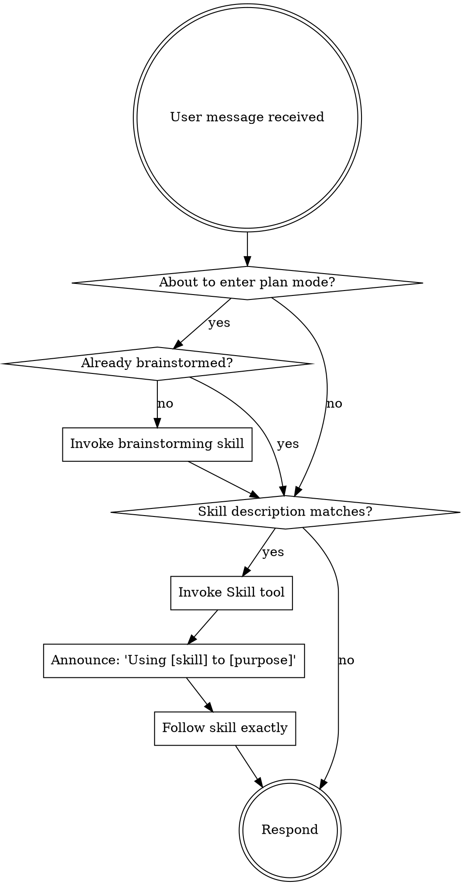

<HARD-GATE>
If a skill's description matches the task, load it before responding. This applies to clarifying questions too — check for skills first, then ask.
</HARD-GATE>

# Using Skills

## How to Access Skills

**In OpenCode:** Use the `Skill` tool. When you invoke a skill, its content is loaded — follow it directly. Never read skill files with the Read tool.

**In other environments:** Check your platform's documentation for how skills are loaded.

## The Rule

**Invoke matching skills BEFORE any response or action**, including clarifying questions. If an invoked skill turns out not to apply, you don't have to use it — but you still checked.

## Red Flags

| Thought | Action |
|---------|--------|
| "I'll explore the codebase first" | Check for a skill first — skills tell you how to explore. |
| "I remember this skill" | Load the current version; skills evolve. |
| "The skill is overkill here" | Load it. The skill itself will tell you if it doesn't apply. |
| "I'll do this one small thing first" | Check for skills before any action. |

## Skill Priority

When multiple skills could apply:

1. **Process skills first** (brainstorming, debugging) — these determine HOW to approach the task.
2. **Implementation skills second** (frontend-design, mcp-builder) — these guide execution.

"Let's build X" → brainstorming first, then implementation skills.
"Fix this bug" → debugging first, then domain-specific skills.

## Skill Types

- **Rigid** (TDD, debugging): Follow exactly.
- **Flexible** (patterns): Adapt principles to context.

The skill itself states which.

## User Instructions

Instructions say WHAT, not HOW. "Add X" or "Fix Y" doesn't mean skip workflows.
